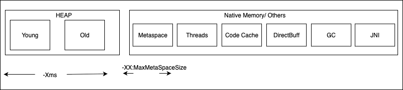

- [JVM Memory](#jvm-memory)

# JVM Memory


1. When we create any new object, that object goes to young generation area, objects staying for longer time in young generation gets promoted to old generation.
2. Metaspace contains metadata required to execute programs. Metadata such as Class definition, method definition ....etc


## Understanding how a sample java program Executed
[Program 1](/)
```
 class Test{
     main(){
            fun1();
        }
    fun1()
 }
```
